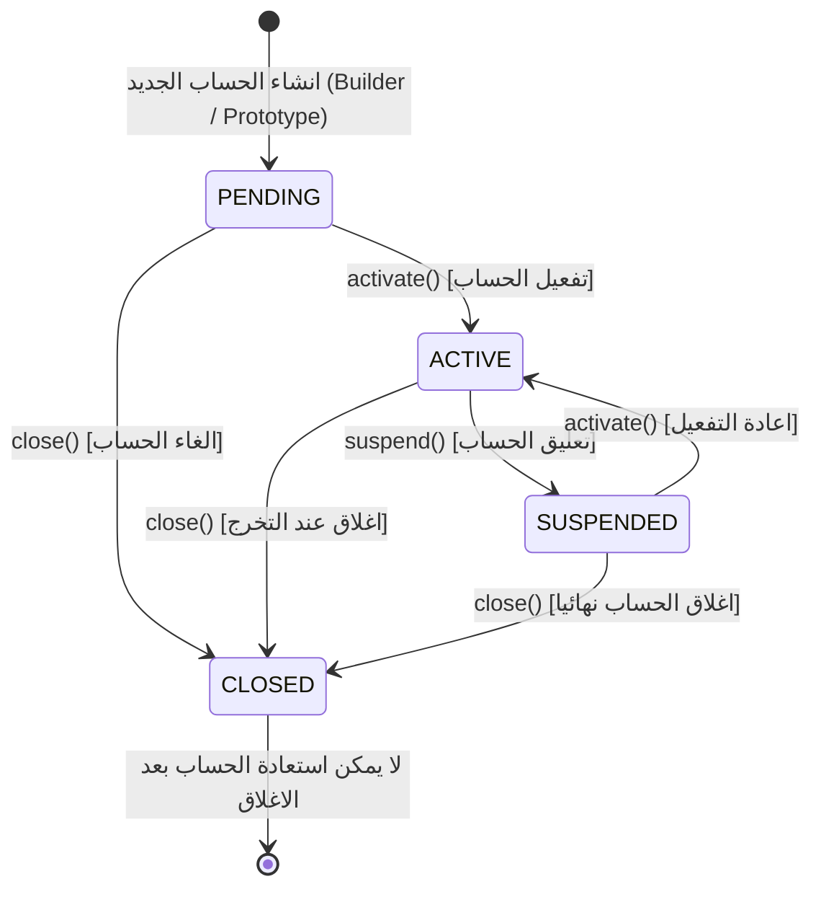
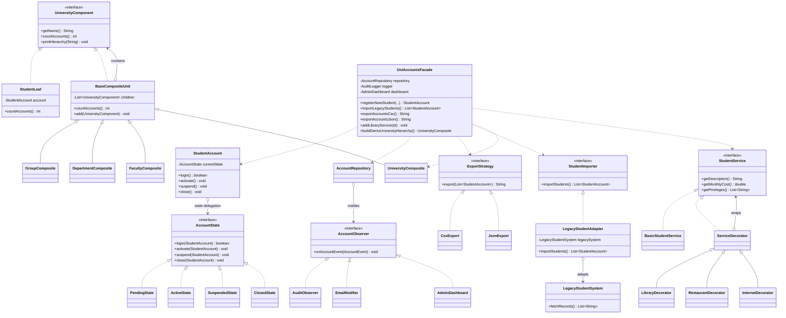

# مخططات الاصناف وحالات النظام (UML Diagrams)

---

## 1. مخطط حالات دورة حياة الحساب (State Machine Diagram)

يوضح انتقال الحساب بين الحالات الاربع (PENDING, ACTIVE, SUSPENDED, CLOSED):



---

## 2. مخطط الاصناف العام للأنماط الانشائية (Work 1 - Creational Patterns)

```mermaid
classDiagram
    class StudentAccount {
        -String id
        -String fullName
        -String email
        -String phone
        -String level
        -String major
        -boolean scholarship
        -List~String~ courses
        -AccountState currentState
        +clone() StudentAccount
        +cloneWithNewIdentity(newId, newName, newEmail) StudentAccount
        +login() boolean
        +activate() void
        +suspend() void
        +close() void
    }

    class Builder {
        -String id
        -String fullName
        -String email
        -String phone
        -String level
        -String major
        -boolean scholarship
        -List~String~ courses
        +phone(String) Builder
        +level(String) Builder
        +major(String) Builder
        +scholarship(boolean) Builder
        +courses(List) Builder
        +build() StudentAccount
    }

    class AccountRepository {
        -static AccountRepository INSTANCE
        -Map~String, StudentAccount~ accountsMap
        -List~AccountObserver~ observers
        +getInstance() AccountRepository
        +addAccount(StudentAccount) void
        +findById(String) Optional~StudentAccount~
        +getAllAccounts() List~StudentAccount~
    }

    class AuditLogger {
        -static AuditLogger INSTANCE
        -List~String~ memoryLogs
        +getInstance() AuditLogger
        +log(action, details) void
        +getLogs() List~String~
    }

    StudentAccount +-- Builder : Nested Static Class
    AccountRepository ..> StudentAccount : stores
    AccountRepository ..> AuditLogger : logs operations
```

---

## 3. مخطط الاصناف الشامل للعملين معا (Work 2 - Comprehensive Class Diagram)


